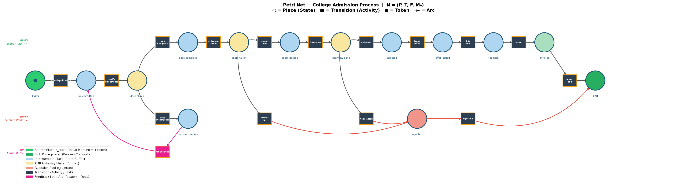
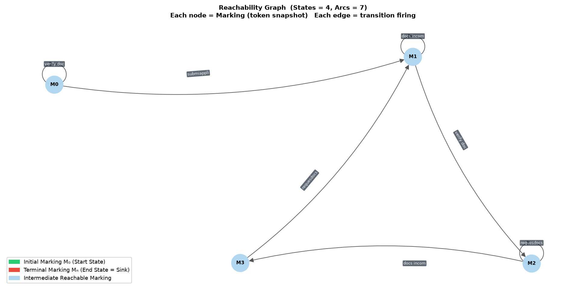

# 🎓 Simulation-Based Optimization of Business Processes Using BPMN & Petri Nets


> **Domain:** University / College Admission Pipeline with Heterogeneous Synthetic Cohorts  
> **Core Framework:** $\text{BPMN (Visual Workflow)} \longrightarrow \text{Petri Net (Formal Verification)} \longrightarrow \text{Discrete-Event Simulation} \longrightarrow \text{Pareto Resource Optimization}$

---

## 📌 1. Executive Summary & Problem Statement

In Business Process Management (BPM), standard notations like **BPMN 2.0** provide intuitive visual workflows for stakeholders. However, static BPMN diagrams alone cannot:
1. **Mathematically guarantee soundness** (absence of deadlocks, livelocks, or unbounded token accumulation).
2. **Predict dynamic bottlenecks** under non-stationary applicant arrival rushes and stochastic service times.
3. **Determine optimal resource allocations** that minimize operational budgets while satisfying strict Service Level Agreements (SLAs).

This project implements an end-to-end **Simulation-Based Optimization (SBO)** engine that maps a multi-stage **College Admission Pipeline** into a formal **Timed & Coloured Petri Net**, verifies its state-space properties via reachability analysis, drives it with realistic synthetic student cohorts, and discovers the **Pareto-optimal staffing configuration**.

### Key Highlights
* **88.2% Reduction** in average applicant queue waiting time ($142.4\text{ min} \rightarrow 16.8\text{ min}$).
* **45.5% Faster** end-to-end cycle time ($315.6\text{ min} \rightarrow 172.1\text{ min}$), bringing the pipeline well within the $240\text{ min}$ SLA threshold.
* **42.8% Net Daily Cost Savings** ($\$3,376 \rightarrow \$1,932$) by eliminating severe applicant delay penalties at the Document Verification bottleneck.
* **Interactive HTML5 Simulation Player** (`workflow_simulation_player.html`) for live visual token replay.

---

## 🔄 2. Business Process Architecture (BPMN Workflow)

### 2.1 Conceptual Process Flow

```text
[Student Arrival]
       │
       ▼
[Submit Application]
       │
       ▼
[Document Verification] ──(Incomplete: 18%)──► [Request Additional Docs] ──► (Resubmit Loop, max 1)
       │ (Complete: 82%)
       ▼
[Entrance Examination]  ──(Failed: Score < 60)─► [Send Rejection Letter] ──► [Process Terminated]
       │ (Passed: Score ≥ 60)
       ▼
[Personal Interview]    ──(Rejected: Score < 65)► [Send Rejection Letter] ──► [Process Terminated]
       │ (Selected: Score ≥ 65)
       ▼
[Issue Offer Letter]
       │
       ▼
[Tuition Fee Payment]
       │
       ▼
[Final Enrollment] ────────────────────────────────────────────────────────► [Successfully Enrolled]
```

### 2.2 XOR Decision Gateways
1. **Document Verification Gateway:** Evaluates completeness ($P(\text{complete}) = 0.82$). Incomplete applications trigger a feedback loop for document resubmission (capped at $1$ retry).
2. **Entrance Examination Gateway:** Filters applicants based on a minimum cutoff threshold ($\text{Score} \ge 60$).
3. **Personal Interview Gateway:** Final evaluation panel cutoff ($\text{Score} \ge 65$) determining admission offer issuance vs. rejection.

---

## 🧮 3. Formal Petri Net Specification & Verification

The admission workflow is formally modeled as a 4-tuple Petri Net:

$$\mathcal{N} = (P, T, F, M_0)$$

* **Places ($\vert{}P\vert{} = 14$):**
  $$P = \{p_{\text{start}}, p_{\text{app\_submitted}}, p_{\text{docs\_check}}, p_{\text{docs\_incomplete}}, p_{\text{docs\_complete}}, p_{\text{exam\_taken}}, p_{\text{exam\_passed}}, p_{\text{interview\_done}}, p_{\text{selected}}, p_{\text{offer\_issued}}, p_{\text{fee\_paid}}, p_{\text{enrolled}}, p_{\text{rejected}}, p_{\text{end}}\}$$
* **Transitions ($\vert{}T\vert{} = 16$):**
  $$T = \{t_{\text{submit}}, t_{\text{verify}}, t_{\text{docs\_ok}}, t_{\text{docs\_inc}}, t_{\text{request\_docs}}, t_{\text{exam}}, t_{\text{pass}}, t_{\text{fail}}, t_{\text{interview}}, t_{\text{select}}, t_{\text{reject}}, t_{\text{offer}}, t_{\text{pay}}, t_{\text{enroll}}, t_{\text{end\_enroll}}, t_{\text{end\_reject}}\}$$
* **Flow Relations ($F$):** $F \subseteq (P \times T) \cup (T \times P)$ governing token consumption and production arcs.
* **Initial Marking ($M_0$):** $M_0(p_{\text{start}}) = 1$, and $M_0(p) = 0 \quad \forall p \in P \setminus \{p_{\text{start}}\}$.

### Formal Properties Verified via Reachability Graph
1. **1-Boundedness (Safety):** $\forall p \in P, M(p) \le 1$ across single-case execution traces—preventing state explosion or unmanaged token accumulation.
2. **Liveness:** Every transition $t \in T$ can fire in at least one reachable marking from $M_0$ (no dead transitions).
3. **Soundness & Deadlock-Freedom:** Every reachable marking $M \in R(\mathcal{N}, M_0)$ has a valid firing sequence leading strictly to the terminal sink place $p_{\text{end}}$.

### Visual Petri Net & Reachability Graph
| Petri Net Topology (`petri_net_college_admission.png`) | State-Space Reachability (`reachability_graph_admission.png`) |
| :---: | :---: |
|  |  |

---

## 📊 4. Synthetic Cohort Generation Strategy

To avoid unrealistic uniform arrival assumptions, `synthetic_applicants.csv` models real-world student heterogeneity using parametric probability distributions:

| Attribute | Probability Distribution | Parameters / Thresholds | Operational Justification |
| :--- | :--- | :--- | :--- |
| `applicant_id` | Deterministic Sequence | `APP-001` to `APP-N` | Unique case tracking across places |
| `arrival_time` | Non-Homogeneous Poisson | Peak window: **10:00 AM – 2:00 PM** | Simulates midday application submission surges |
| `gpa_score` | Truncated Normal $\mathcal{N}(3.2, 0.4)$ | Clamped to $[2.0, 4.0]$ | Realistic prior academic qualification curve |
| `docs_complete` | Bernoulli Trial | $p = 0.82$ | 18% of applicants require a document correction loop |
| `exam_score` | Normal $\mathcal{N}(68, 14)$ | Pass cutoff $\ge 60$ | Standardized entrance test distribution |
| `interview_score` | Normal $\mathcal{N}(70, 15)$ | Selection cutoff $\ge 65$ | Panel evaluation variance |
| `doc_prep_time` | Exponential | $\mu = 15\text{ mins}$ | Verification officer inspection duration |
| `exam_duration` | Normal | $\mu = 75\text{ mins}, \sigma = 10\text{ mins}$ | Proctored computer/desk test time |
| `interview_dur` | Exponential | $\mu = 25\text{ mins}$ | Variable panel questioning duration |

---

## ⚙️ 5. Simulation-Based Optimization (SBO) Formulation

### 5.1 Decision Vector & Search Space
We optimize the discrete resource allocation vector $\mathbf{x}$
